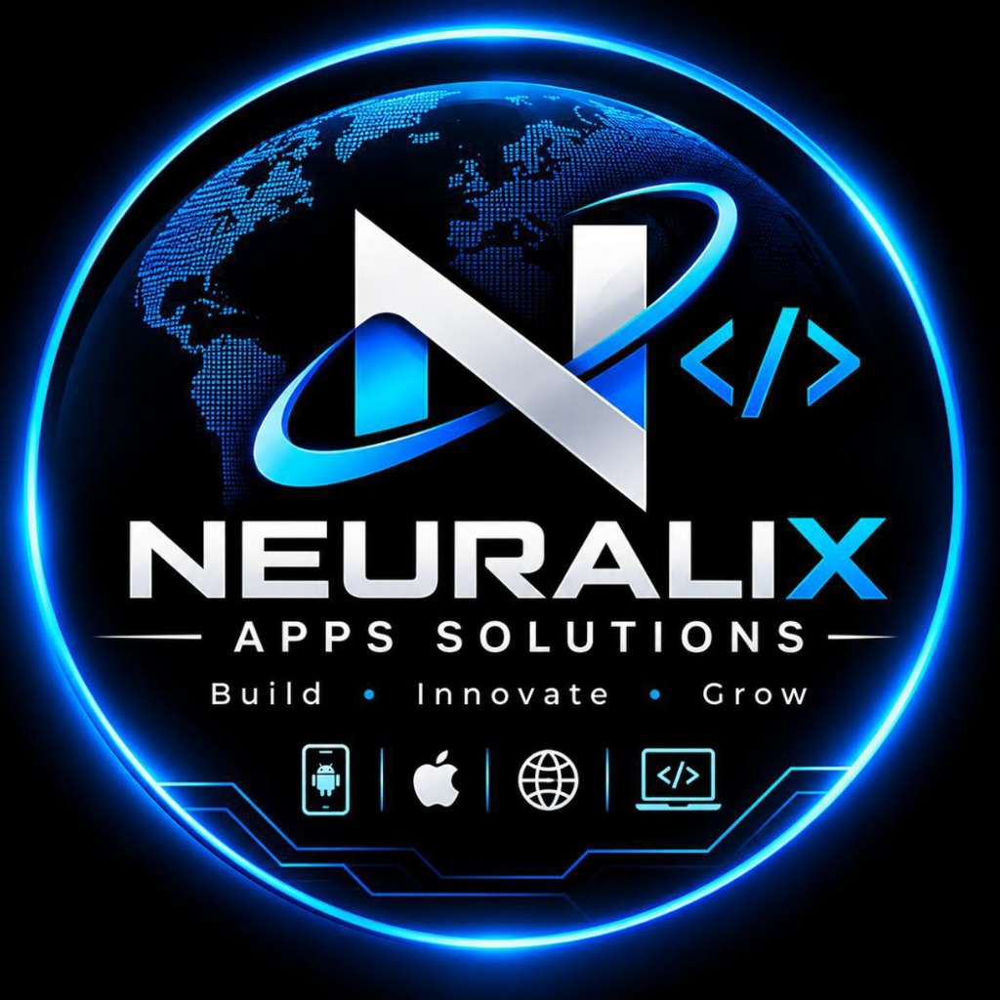

# Neuralix Apps Solutions

<p align="center">
  
</p>

<h3 align="center">Build • Innovate • Grow</h3>

<p align="center">
  <strong>Premier IT Freelancing & Software Development Agency</strong><br>
  Led by <strong>Mr. Hemant Lakhara</strong> • Based in <strong>Gurgaon, India</strong>
</p>

---

## 🚀 About Neuralix Apps Solutions

**Neuralix Apps Solutions** unites dedicated full-stack engineering strength with the agility of specialized independent freelancers. Under the leadership of **Mr. Hemant Lakhara**, we have successfully engineered and delivered **20+ mobile applications and web platforms for foreign clients** across the United States, Europe, Australia, and the Middle East.

### 🌟 Core Services
1. **App Development**: Native (iOS & Android) and Cross-Platform (Flutter, React Native) mobile applications with 60fps fluid UI, offline-first sync, and store publishing.
2. **Website Development**: Modern, responsive, and ultra-fast web applications, SaaS dashboards, and client portals built using Next.js, React, Node.js, and cloud backends.
3. **Custom Software Development**: Bespoke internal operations tools, automated business workflows, scalable RESTful/GraphQL APIs, and database architectures.
4. **UI / UX Design**: Intuitive, conversion-driven user experiences crafted in Figma with interactive high-fidelity prototypes and design systems.
5. **Help to Grow Business Digitally**: Digital transformation, technical SEO, cloud optimization, performance scaling, and global expansion strategy.

---

## 📂 Project Structure

This repository includes two production-ready implementations:

- **Flutter Web / Multi-Platform (`lib/`)**:
  - `lib/main.dart`: Complete application entry point with smooth navigation.
  - `lib/theme/app_theme.dart`: Cyber blue gradient & crisp white aesthetic theme.
  - `lib/widgets/code_background.dart`: Animated coding background with floating programming glyphs and cyber grid particles.
  - `lib/widgets/hero_section.dart`: Animated hero section with brand badge spotlight.
  - `lib/widgets/stats_section.dart`: Global track record & delivery statistics.
  - `lib/widgets/services_section.dart`: Interactive service cards with tech chips.
  - `lib/widgets/about_owner_section.dart`: Founder spotlight for Mr. Hemant Lakhara and engineering team.
  - `lib/widgets/testimonials_section.dart`: 4 international client reviews and portfolio highlights.
  - `lib/widgets/contact_form_section.dart`: Project inquiry form transmitting directly to `neuralixapps.official@gmail.com`.
  - `lib/widgets/footer_section.dart`: Cyber footer with social handles, contact, and privacy policy links.

- **Standalone Web Version (`website/`)**:
  - `website/index.html`: Lightweight, zero-dependency HTML5/CSS3/JavaScript landing page with interactive canvas code animation.
  - `website/privacy-policy.html`: Official Neuralix Apps Solutions privacy policy.
  - `website/logo.png`: High-resolution circular branding logo.

---

## 🛠️ How to Run

### Option A: Run Flutter Web Application
```bash
# Get dependencies
flutter pub get

# Run on Chrome
flutter run -d chrome

# Build for Web production
flutter build web --release
```

### Option B: Run Standalone HTML/CSS/JS Website
Open `website/index.html` directly in any web browser or deploy the `website/` folder to GitHub Pages, Vercel, Netlify, or cPanel.

---

## 📬 Contact & Inquiries

- **Main Owner:** Mr. Hemant Lakhara
- **LinkedIn:** [linkedin.com/in/hemant-l-06ba8821a](https://www.linkedin.com/in/hemant-l-06ba8821a)
- **Official Email:** [neuralixapps.official@gmail.com](mailto:neuralixapps.official@gmail.com)
- **Instagram:** [@neuralix_apps_solutions](https://www.instagram.com/neuralix_apps_solutions)
- **Headquarters Location:** Gurgaon, India
- **Privacy Policy:** [Privacy Policy](website/privacy-policy.html)

---

<p align="center">
  © 2026 Neuralix Apps Solutions. All Rights Reserved. Founded by Mr. Hemant Lakhara.
</p>
